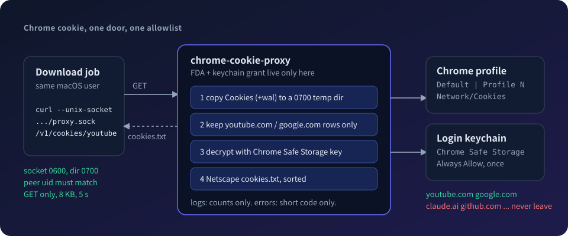

# chrome-cookie-proxy

一个只服务本机的小型 Swift 服务：从 Chrome 的 Cookies 库里取出白名单域名的 cookie，以 Netscape `cookies.txt` 的格式通过 unix socket 交给同一个用户下的客户端。

## 为什么要有它

`yt-dlp --cookies-from-browser chrome` 要读 Chrome 的 Cookies 库，macOS 要求读它的进程拥有完全磁盘访问权限（FDA），解密还要用登录钥匙串里的 “Chrome Safe Storage”。把这两项授权给 Python 解释器意味着任何 Python 脚本都能读走整个磁盘和所有站点的 cookie，而且 uv 每升级一次 Python 补丁版就会换一个二进制，授权又要重做。这个服务把两项授权收进一个专用的、签过名的二进制里，它只会导出白名单里的域名，别的站点的 cookie 连同钥匙串密码都不出这个进程。

## 安全模型

服务只监听 unix socket，不监听任何 TCP 端口。socket 受文件系统权限保护，并且每个连接都能用 `getpeereid` 拿到对方进程的真实 uid；回环 TCP 做不到这两点，本机的任何用户、任何进程，甚至浏览器里的网页（通过 DNS rebinding 或跨站请求）都能碰到它。启动时服务会创建 socket 所在目录并设为 `0700`，目录不属于当前用户就拒绝启动，socket 文件本身是 `0600`，每个连接的对端 uid 必须在白名单里（默认只有服务自己的 uid），否则直接关闭并记一行日志。

这个模型保护的边界要说清楚：同一个用户下的进程依然可以连上 socket，所以它防的是“别的用户和网页”，防不了“同一用户下的恶意进程”。但这类进程拿到的只是白名单里的 cookie，既拿不到钥匙串密码，也拿不到别的站点，这比把 FDA 交给通用解释器要小得多。白名单是编译期写死的表（`youtube` 对应 `youtube.com` 和 `google.com`），host_key 去掉开头的 `.` 之后，等于后缀或以 `.` + 后缀结尾才算命中，所以 `accounts.google.com` 命中，`notyoutube.com`、`google.com.evil.io` 不命中；要增加域名只能改代码重新签名发布。

服务从不直接打开 Chrome 正在用的数据库，而是把 `Cookies`（以及存在的 `-wal`、`-journal`）复制到一个 `0700` 的私有临时目录，只读打开副本，用完删掉整个目录。日志写在 stderr，一次请求一行，只有时间、方法、路径、状态码、导出和跳过的条数、使用的 profile 名；cookie 的名字、值和钥匙串密码从不进入日志，出错时响应体也只有一个短错误码，不带任何数据。每个连接最多读 8 KB、最多等 5 秒，请求只看第一行，连接串行处理。

## 用法

```
chrome-cookie-proxy serve [--socket <path>] [--chrome-root <dir>] [--profile <name>]
                          [--allow-uid <uid>]... [--socket-mode <octal>]
chrome-cookie-proxy version
```

| 选项 | 默认值 |
| --- | --- |
| `--socket` | `~/.local/state/chrome-cookie-proxy/proxy.sock` |
| `--chrome-root` | `~/Library/Application Support/Google/Chrome` |
| `--profile` | 自动选择：`Default` 和 `Profile *` 里 Cookies 文件修改时间最新的（和 yt-dlp 一致） |
| `--allow-uid` | 不传：只允许服务自己的 uid。可重复；每个值都是额外放行的 uid，服务自己的 uid 永远在白名单里 |
| `--socket-mode` | `0600`。八进制，最多 `0777`，属主必须保留读写（`0600` 位）；`0666` 让其他 uid 有权限 `connect()` |

两个新选项合起来用，才能让另一个用户（例如以 `dsh-runtime` 身份跑的 AMS 服务）取 cookie，两层缺一不可：`--allow-uid` 决定**谁**的请求会被处理（`getpeereid` 拿到的真实 uid，伪造不了），`--socket-mode` 只是放开 socket 文件的权限位，让别的 uid 的 `connect()` 能走到服务那一步。socket 所在目录仍是 `0700`，别的用户要进得去，得在目录上显式加 ACL（`chmod +a "dsh-runtime allow search,readattr" <dir>`；`chmod` 重新收紧到 `0700` 不会清掉 ACL）。目录 ACL 和 uid 白名单是两道独立的门：没有 ACL，别的用户连 socket 路径都解析不到；不在白名单里，连上了也会被立刻关闭，并写一行 `rejected connection: peer uid <uid> not in allowed uids [...]`（只放行一个 uid 时保持原样的 `peer uid <uid> != <允许的 uid>`）。例如 AMS 下的部署：

```bash
mkdir -m 700 /Users/Shared/chrome-cookie-proxy
chmod +a "dsh-runtime allow search,readattr" /Users/Shared/chrome-cookie-proxy
chrome-cookie-proxy serve --socket /Users/Shared/chrome-cookie-proxy/proxy.sock --allow-uid 502 --socket-mode 0666
```

`--socket` 的目录必须属于当前用户（服务会把它收紧到 `0700`），所以不能把 socket 直接放在 `/tmp` 下，放在 `/tmp/foo/` 之类自己的子目录里即可。unix socket 的路径最长 103 字节。

| 请求 | 响应 |
| --- | --- |
| `GET /healthz` | `200 ok`，不碰 cookie 和钥匙串 |
| `GET /v1/cookies/youtube` | `200` 加 Netscape cookies.txt |
| `GET /v1/cookies/<其他>`、其他路径 | `404` |
| 非 GET 方法 | `405`（带 `Allow: GET`） |
| 请求格式不对、超过 8 KB | `400`（`bad_request`、`request_too_large`） |
| 5 秒内没发完请求行和头部 | `408` |
| 内部错误 | `500`，响应体是 `chrome_root_unreadable`（没有 Full Disk Access）、`keychain_denied`、`cookies_db_unreadable`、`no_profile`、`internal_error` 之一 |

客户端：

```bash
curl -fsS --unix-socket ~/.local/state/chrome-cookie-proxy/proxy.sock \
  http://localhost/v1/cookies/youtube -o cookies.txt
yt-dlp --cookies cookies.txt <url>
```

建议定时任务先写临时文件再 `mv`，并加 `--max-time 30`：钥匙串第一次授权的弹窗没处理之前，请求会一直等着。

导出的格式是第一行 `# Netscape HTTP Cookie File`，之后每条 cookie 一行、七列用 tab 分隔（domain、includeSubdomains、path、secure、expiry、name、value），按 domain、name 排序所以输出稳定；expiry 由 Chrome 的 `expires_utc`（自 1601-01-01 的微秒）换算成 unix 秒，session cookie 保持 0，不加 `#HttpOnly_` 前缀。解密失败、前缀不是 `v10`、host 哈希对不上（schema 24 起 Chrome 会在明文前加 SHA256(host_key)）或者任何字段里含 tab、换行的 cookie 会被跳过并计入 `skipped`，不会中断整个导出。

## 构建与签名

需要 Xcode（Swift 6）和钥匙串里的 Developer ID 证书。

```bash
swift test
swift build -c release
SIGN_ID="Developer ID Application: <name> (<TEAMID>)"   # security find-identity -v -p codesigning
codesign --force --timestamp --options runtime -i chrome-cookie-proxy -s "$SIGN_ID" .build/release/chrome-cookie-proxy
codesign -dv --verbose=2 .build/release/chrome-cookie-proxy   # Identifier、TeamIdentifier、flags=0x10000(runtime)
```

`-i chrome-cookie-proxy` 固定了签名的 identifier，加上 Team ID，重新构建之后代码要求保持不变，FDA 和钥匙串的授权才不会因为升级而失效。

## 部署（macOS，用户 LaunchAgent）

```bash
mkdir -p ~/.local/libexec/chrome-cookie-proxy ~/.local/state/chrome-cookie-proxy ~/Library/LaunchAgents
cp .build/release/chrome-cookie-proxy ~/.local/libexec/chrome-cookie-proxy/
sed "s|__HOME__|$HOME|g" deploy/app.lishuyu.chrome-cookie-proxy.plist \
  > ~/Library/LaunchAgents/app.lishuyu.chrome-cookie-proxy.plist
launchctl bootstrap gui/$(id -u) ~/Library/LaunchAgents/app.lishuyu.chrome-cookie-proxy.plist
```

launchd 不会展开 `~`，所以示例 plist 里用 `__HOME__` 占位，上面的 `sed` 把它换成绝对路径。label 是 `app.lishuyu.chrome-cookie-proxy`，`RunAtLoad` 和 `KeepAlive` 都开着，stderr 写到 `~/.local/state/chrome-cookie-proxy/proxy.log`。

首次运行要在这台机器的图形界面里（本机或屏幕共享）做两件事，没法在纯 ssh 里完成：

1. 打开 系统设置 > 隐私与安全性 > 完全磁盘访问权限，点 “+”，按 Cmd+Shift+G 输入 `~/.local/libexec/chrome-cookie-proxy/chrome-cookie-proxy` 添加并打开开关，然后 `launchctl kickstart -k gui/$(id -u)/app.lishuyu.chrome-cookie-proxy` 重启服务。
2. 发一次 `curl --max-time 120 --unix-socket ~/.local/state/chrome-cookie-proxy/proxy.sock http://localhost/v1/cookies/youtube -o /dev/null`，macOS 会弹出 “chrome-cookie-proxy 想要使用钥匙串中的 Chrome Safe Storage”，输入登录密码并选 “始终允许”。

之后验证：`curl --unix-socket ~/.local/state/chrome-cookie-proxy/proxy.sock http://localhost/healthz` 应该返回 `ok`，`tail ~/.local/state/chrome-cookie-proxy/proxy.log` 能看到请求行。升级时用同一个证书和 identifier 重新签名，先拷成同目录下的临时文件名再 `mv` 过去（不要原地覆盖正在运行的二进制，内核会因签名页失效杀掉进程），然后 `launchctl kickstart -k gui/$(id -u)/app.lishuyu.chrome-cookie-proxy`，用 `chrome-cookie-proxy version` 确认版本。FDA 和钥匙串授权都跟着代码要求走，升级后不用重新授权。

## 测试

`swift test` 不碰真实的 Chrome 和钥匙串，所有数据都是测试里造的。PBKDF2 的期望值来自 Python 的 `hashlib.pbkdf2_hmac`，AES 的密文来自 `openssl enc -aes-128-cbc`，两者都独立于被测实现；集成测试在临时目录里用 SQLite C API 造一个带 `Default` 和 `Profile 1` 的假 Chrome 根目录，端到端测试在临时路径上起真正的 socket 服务，用 Darwin socket 写的客户端去请求。

## 已知限制

- 连接是串行处理的，钥匙串弹窗没处理之前后面的请求都会排队，所以客户端要设超时。
- 复制数据库和 Chrome 写入之间没有锁，极少数情况下会读到不一致的副本，表现为 `cookies_db_unreadable`，重试即可。
- 自动选 profile 用的是 Cookies 文件的修改时间，和 yt-dlp 的行为一致，如果 Chrome 把近期写入还留在 `-wal` 里，主文件的时间戳可能偏旧，这时用 `--profile` 指定。
- 只支持 macOS 上 Chrome 的 `v10` 加密格式。
